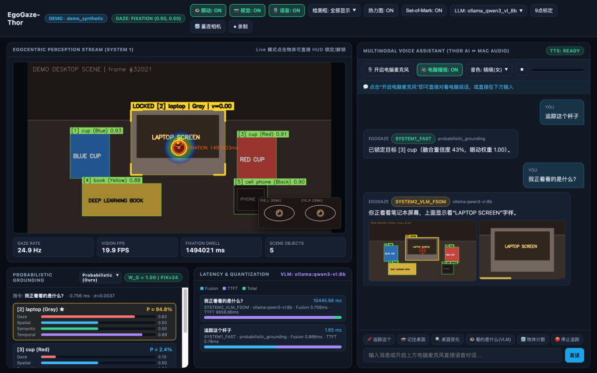
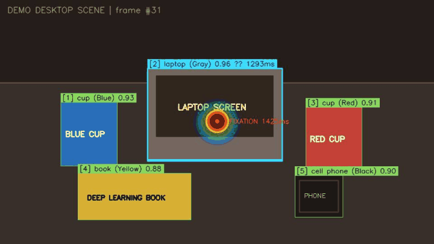
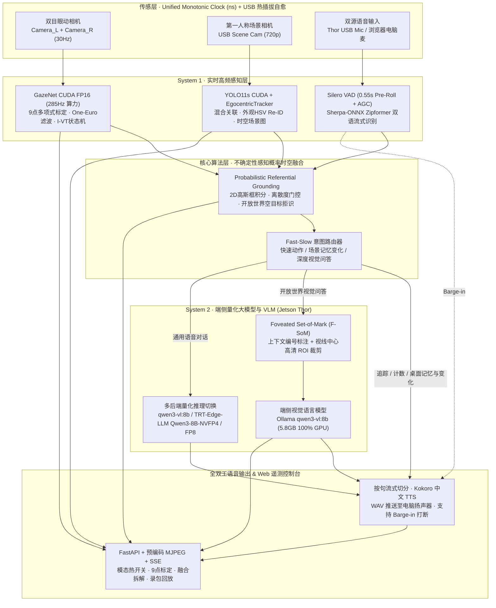

# EgoGaze-Thor

**Egocentric Gaze-Guided Open-World Multimodal Perception & Full-Duplex Voice Agent on NVIDIA Jetson Thor**

[](https://www.nvidia.com/)
[](https://www.python.org/)
[](LICENSE)
[](#)

**EgoGaze-Thor** 是一套面向第一人称可穿戴 / 具身交互场景的**端侧多模态感知与全双工语音交互系统**，完全运行于 **NVIDIA Jetson Thor** 边缘计算平台（122 GiB 统一内存）。

系统融合了**高频双目眼动追踪**、**通用桌面/室内视觉检测与外观重捕获追踪（Re-ID）**、**不确定性感知的概率时空指代融合（含开放世界空目标拒识）**、**视线引导的端侧多模态大模型（Foveated Set-of-Mark VLM）**、以及**全双工流式语音闭环（Zipformer ASR + Kokoro TTS + Barge-in 打断）**，并通过零构建暗色 **Web 实时遥测控制台**实现远程交互、可视化解释与数据集录包评测。

### 实时控制台与交互演示

<p align="center">
  
</p>
<p align="center">
  <em>Web 实时遥测控制台：顶部模态热开关与检测框模式 · 左上 HUD 锁定与双目眼动 PiP · 左下概率时空融合拆解与延迟瀑布图 · 右侧全双工语音助手及端侧 Qwen3-VL F-SoM + ROI 推理预览</em>
</p>

<details>
<summary>🎬 点击展开：视线引导概率融合 + HUD 动态目标锁定演示 (GIF)</summary>
<p align="center">
  
</p>
</details>

---

## 核心技术路线与创新点

### 1. 架构总览（Fast-Slow 双系统多模态闭环）



---

### 2. 六大核心技术模块详解

#### ① 高频眼动感知、9 点标定与 I-VT 凝视状态机 (`perception/gaze_engine.py`)
- **GPU FP16 推理加速**：双目 `GazeNet` 在 Jetson Thor 上以 CUDA FP16 运行，单帧耗时 **3.51 ms（285 Hz 吞吐）**，轻松锁定 25~30 Hz 实时输出。
- **浏览器内交互式 9 点标定**：采用二次多项式 Ridge 回归（6 维特征 $[1, u, v, u^2, uv, v^2]$）拟合个体佩戴映射并持久化至 `configs/calibration.json`，替代硬编码偏移。
- **2D One-Euro 滤波 + I-VT 状态机**：静止注视强平滑去抖、快速眼跳低延迟跟随；基于速度阈值输出 `FIXATION` / `SACCADE` / `INVALID` 语义状态，并计算实时注视驻留时长（`dwell_ms`）和空间离散度（$\sigma_g$）。

#### ② 不确定性感知的概率时空指代融合 + 开放世界空目标拒识 (`fusion/grounding.py`)
给定语音时间窗 $[t_s - 350\text{ms}, t_e + 200\text{ms}]$ 内的眼动轨迹 $G$、语音语义线索 $U$ 与场景候选集合 $\mathcal{O}$，采用对数线性贝叶斯融合模型计算每个目标的后验概率：

$$\log P(o_i \mid G, U, V) = w_g(\sigma_g, r_{\text{fix}}) \log \tilde{p}_{\text{gaze}}(o_i) + w_p \log \tilde{p}_{\text{spatial}}(o_i) + w_s \log \tilde{p}_{\text{semantic}}(o_i) + w_t \log \tilde{p}_{\text{temporal}}(o_i) - \log Z$$

- **闭式 2D 高斯边界框积分**：通过 `math.erf` 解析计算注视高斯分布在任意大小目标框内的概率质量，对小物体与大物体均公平。
- **不确定性门控 & 均匀背景混合似然**：当用户处于扫视（`SACCADE`）或眼动漂移时，可靠性门控 $w_g(\sigma_g, r_{\text{fix}}) \to 0$ 平滑衰减；均匀背景混合似然防止眼动-语音空间冲突时的极端 $\log(0)$ 否决。
- **开放世界空目标拒识（Open-World Null-Object Rejection）**：当用户使用纯指代词（“我正看着的是什么？”）且稳定注视点落在**所有闭集检测框之外**时，拒绝强行锁定旁边无关的 YOLO 目标，无缝移交 System 2 VLM 以红十字注视点为中心进行开放世界识别。

#### ③ 第一人称鲁棒追踪 + 外观 Re-ID + 桌面场景记忆 (`perception/vision_fast.py`, `pipeline.py`)
- **`_EgocentricTracker` 混合关联器**：针对头戴相机剧烈晃动导致纯 IoU=0、ID 频繁碎片化的问题，融合 **IoU（0.42）+ 归一化中心接近度高斯核（0.34）+ 尺度相似度（0.12）+ HSV 颜色直方图相似度（0.12）**，并引入兼容类别组消除单帧类别抖动。
- **外观 Re-ID 自动重捕获**：锁定目标时保存 HSV 外观签名；遮挡或快速转头丢框时先保持 30 帧 `REACQUIRING` 惯性，随后进入 `SEARCHING` 状态，目标重回视野后自动无缝锁回。
- **HUD 战术追踪视觉 & 桌面变化检测**：支持四角瞄准框 + 聚光灯压暗 + 36 帧运动轨迹线；支持语音/按钮 **“记住桌面” → “桌面有什么变化？”**，基于时空场景图自动播报新增、拿走和移动的物体。

#### ④ 视线引导的 Foveated Set-of-Mark (F-SoM) 端侧 VLM (`perception/fom_prompt.py`, `reasoning/vlm_client.py`)
- **双图中央凹视觉提示**：发送给 `qwen3-vl:8b` 的输入由两张图组成：① 带编号框 `[1],[2]...` 与红色注视十字的上下文图（512px）；② 高清局部放大图（Foveated ROI，336px）——若命中检测框则裁剪目标框，若触发开放世界空目标拒识则直接围绕**红色注视十字中心**裁剪，精准读出书本、手势数字、标签文字等细粒度信息。
- **Thor 端侧低延迟优化**：通过 `num_ctx=4096` + `keep_alive=30m` + 空思考预填（`<think>\n\n</think>\n`），将 `qwen3-vl:8b` 显存占用从默认 45 GB 压缩至 **5.8 GB（100% GPU）**，生成速度约 **35 tokens/s**，首字延迟降至亚秒级。

#### ⑤ 全双工流式语音闭环（Thor 计算 ↔ 电脑收放音）(`speech/`)
- **流式 ASR**：`Silero VAD`（0.55s Pre-Roll 预缓冲防吞字头 + 主动队列排空 + 自动增益 AGC）+ `Sherpa-ONNX Zipformer` 中英双语流式识别，同时兼容 **Thor USB 麦克风**与**浏览器电脑麦克风**。
- **流式中文 TTS + Barge-in 打断**：按标点句级切块驱动 `Kokoro` 原生中文音色（`sid=45~52`：晓晓 / 晓贝 / 晓伊 / 云希 / 云扬），在 Thor 合成 WAV 后经 SSE 推送到浏览器直接由电脑扬声器播报，开口说话瞬间自动触发 **Barge-in 打断**。

#### ⑥ 工业级稳定性与实时 Web 遥测控制台 (`sensors/live_devices.py`, `web/`)
- **纯 Sysfs USB 相机热插拔自愈**：大晃动引发 USB 瞬断导致 `/dev/videoX` 节点漂移时，自动释放死句柄、毫秒级扫描 `/sys/class/video4linux/video*/{name,index}` 找回新节点并在 1~2 秒内恢复视频流。
- **实时多模态控制台**：单页零构建暗色控制台，支持 **3 模态热开关**（`👁 眼动 / 📷 视觉 / 🎙 语音`）、**3 档检测框模式**（`全部显示 / 仅注视处 / 完全隐藏`）、**实时融合消融模式切换**（`Probabilistic / Heuristic / Speech-Only / Gaze-Only`）、**实时音色切换**、**融合得分拆解条形图**、**时延瀑布图**与**同步 MP4+JSONL 录包**。

---

## Jetson Thor 实机评测结果

所有指标均在 **NVIDIA Jetson Thor（aarch64, 122 GiB Unified Memory）** 真机上实测获得：

### 1. 模块级性能与端侧推理延迟

| 模块 / 后端 | 精度 / 配置 | 实测指标 |
| :--- | :--- | :--- |
| 双目眼动 `GazeNet` | PyTorch CUDA FP16 (`2x3x36x60`) | **285.0 Hz（3.51 ms/帧）** |
| 概率时空指代融合 | Python + 闭式 `erf` 积分 | **0.085 ms/次** |
| `Qwen3-8B-NVFP4`（TRT-Edge-LLM C++ Daemon） | NVFP4 + CUDA Graph | **TTFT 158 ms** |
| `qwen3-vl:8b`（Ollama 100% GPU） | `num_ctx=4096` + 空思考预填 | **5.8 GB VRAM · ~35 tok/s · 文本 TTFT 721 ms** |
| 实时三目感知流水线（主视角 + 双目 + YOLO11s） | 独立双采集线程 + 后台预编码 MJPEG | **眼动 25 Hz · 视觉 15+ FPS** |

### 2. 多模态指代消解消融实验（`benchmarks/eval_grounding.py`）

覆盖纯指代（“追踪这个”）、同类注视消歧、眼动-语音空间冲突、扫视噪声与混合时序凝视 5 类场景：

| 融合方法 | Accuracy | Correct / Total | Avg Latency |
| :--- | :---: | :---: | :---: |
| `speech_only` | 58.3% | 7 / 12 | 0.102 ms |
| `gaze_only` | 50.0% | 6 / 12 | 0.083 ms |
| `heuristic_baseline`（传统规则基线） | 83.3% | 10 / 12 | 0.037 ms |
| **`probabilistic`（本项目不确定性感知融合）** | **91.7%** | **11 / 12** | **0.085 ms** |

### 3. 第一人称实拍桌面视频追踪稳定性对比（247 帧真机录包回放）

| 追踪器方案 | 247 帧累计最大 `track_id`（越低越稳） | 锁定目标连续保持率 |
| :--- | :---: | :---: |
| 纯 IoU + 匈牙利基线 | `1514`（严重 ID 碎片化） | 64.4%（159 / 247） |
| **`_EgocentricTracker` + HSV 外观 Re-ID（本项目）** | **`26`（ID 裂变减少 58 倍）** | **98.4%（242 / 246，余 4 帧由惯性保持）** |

---

## 目录结构

```text
egogaze/
├── README.md
├── LICENSE
├── pyproject.toml
├── configs/
│   ├── default.yaml               # 可移植默认配置（开箱即用 Demo 模式）
│   ├── example.yaml               # 机器部署配置模板（复制为 configs/local.yaml 覆盖）
│   └── local.yaml                 # 本机私有权重路径覆盖（已加入 .gitignore，自动优先加载）
├── docs/assets/                   # README 控制台实拍图与 HUD 追踪演示 GIF
├── scripts/
│   ├── sync_to_thor.sh            # 本地 -> Thor 一键增量同步
│   ├── run_on_thor.sh             # 同步 + 远程启动 + SSH 8080 端口映射
│   ├── start_llm_thor.sh          # 可选：启动 TRT-Edge-LLM NVFP4 C++ 守护进程
│   └── download_vlm_thor.sh       # 可选：通过镜像下载 HF VLM 权重
├── src/egogaze/
│   ├── cli.py                     # CLI 入口 (live / demo / replay)
│   ├── pipeline.py                # 核心多模态编排、HUD 渲染、桌面场景记忆与变化检测
│   ├── core/                      # Pydantic 数据契约、单调时钟 RingBuffer、遥测统计
│   ├── sensors/                   # Sysfs 热插拔自愈三目采集器、MP4+JSONL 同步录包回放
│   ├── perception/                # GazeNet + 9点标定 + I-VT、EgocentricTracker + Re-ID、F-SoM
│   ├── fusion/                    # 不确定性感知概率时空指代融合 + 开放世界空目标拒识
│   ├── reasoning/                 # Fast-Slow 路由、统一量化 LLM 客户端、Ollama/HF VLM 客户端
│   ├── speech/                    # Zipformer 流式 ASR (Pre-Roll+VAD+AGC)、Kokoro 流式中文 TTS
│   └── web/                       # FastAPI + MJPEG + SSE 后端与零构建暗色控制台前端
├── benchmarks/
│   └── eval_grounding.py          # 多模态指代消解消融评测脚本
└── tests/
    └── test_gaze_and_fusion.py    # 标定、滤波、状态机、融合与切句单元测试
```

---

## 快速开始

### 环境依赖
- **硬件（Live 模式）**：NVIDIA Jetson Thor（或带 CUDA GPU 的 Linux 主机）+ 双目眼动 USB 相机（`Camera_L` / `Camera_R`）+ 主视角 USB 相机 + 麦克风（可选，支持直接用浏览器电脑麦克风）
- **无硬件体验（Demo 模式）**：任意安装 Python 3.10+ 的电脑即可直接运行交互式合成桌面演示
- **Python 依赖**：`torch`, `ultralytics`, `fastapi`, `uvicorn`, `httpx`, `opencv-python`, `scipy`, `scikit-learn`, `pydantic`, `PyYAML`, `sherpa-onnx`, `sounddevice`
- **端侧 VLM（推荐）**：在 Jetson Thor 上通过 Ollama 拉取 `qwen3-vl:8b`：
  ```bash
  ollama pull qwen3-vl:8b
  ```

### 方式一：无硬件交互式 Demo 模式（无需相机/GPU）
```bash
PYTHONPATH=src python3 -m egogaze.cli --mode demo --port 8080
```
打开浏览器访问 **http://localhost:8080**，直接**点击桌面合成画面即可移动模拟视线**，体验概率融合拆解、F-SoM 视觉提示与 HUD 追踪。

### 方式二：Jetson Thor 真机部署与远程交互（Mac/PC 浏览器访问）
1. 复制并按需修改本机权重路径配置（`configs/local.yaml` 已加入 `.gitignore`，启动时自动优先加载）：
   ```bash
   cp configs/example.yaml configs/local.yaml
   ```
2. 使用一键脚本同步代码并在 Thor 上启动（自动建立 `localhost:8080` 端口转发，支持浏览器电脑麦克风）：
   ```bash
   chmod +x scripts/*.sh
   ./scripts/run_on_thor.sh live
   ```
3. 打开浏览器访问 **http://localhost:8080**：
   - 点击右侧 **“🎙️ 开启电脑麦克风”** 即可像日常语音助手一样直接对着电脑说话，并从电脑扬声器听到 Thor 合成的 Kokoro 中文语音回复。
   - 若需与 TensorRT-Edge-LLM 的 `Qwen3-8B-NVFP4` 做对比测试，可在另一终端运行 `./scripts/start_llm_thor.sh` 并在顶部下拉框切换后端。

### 运行测试与消融基准
```bash
# 运行全部核心单元测试
PYTHONPATH=src:tests python3 -c "
import test_gaze_and_fusion as t
for name in sorted(dir(t)):
    if name.startswith('test_'):
        getattr(t, name)()
        print('PASS:', name)
"

# 运行多模态概率融合消融基准
PYTHONPATH=src python3 benchmarks/eval_grounding.py
```

---

## 交互玩法与演示脚本建议

1. **开放世界“看哪问哪”**：把视线看向任意未被 YOLO 框住的物体（书本、纸张、水杯标签、手势比出的数字），问 **“我正看着的是什么？”** 或 **“手的数字是几？”** —— 观察右侧气泡中自动围绕红十字裁剪的 Foveated ROI 与 `qwen3-vl:8b` 的精准回答。
2. **极简 AR 视图 + HUD 鲁棒追踪**：将顶部检测框切到 **`检测框: 仅注视处`** 或 **`完全隐藏`**，点击画面中物体或说 **“追踪这个”**，晃动镜头或用手短暂遮挡，展示聚光灯四角 HUD、36 帧轨迹线与外观 Re-ID 自动重捕获。
3. **桌面时空记忆与变化检测**：说 **“记住桌面”** → 拿走或放上一个新物品 → 问 **“桌面有什么变化？”**，系统将语音播报增删改并高亮新物体。
4. **现场消融演示**：利用顶部 **`👁 眼动 / 📷 视觉 / 🎙 语音`** 模态开关与左下 **`Probabilistic / Heuristic / Speech-Only / Gaze-Only`** 融合模式下拉框，实时展示眼动模态与不确定性门控对指代准确率的提升。

---

## Roadmap（v0.2 规划）

- [ ] 端到端录包离线回放播放器（在 Web 控制台直接回放 `data/recordings/` 并一键生成真实数据集消融报告图表）
- [ ] `TensorRT-Edge-LLM` 编译原生 `Qwen3-VL` 多模态引擎，进一步压缩 System 2 VLM 首字延迟
- [ ] 接入 `YOLOE` / `YOLO-World` 动态开放词表与实时热词注入
- [ ] IMU 头部姿态角融合，进一步提升剧烈头部运动下的眼动与追踪稳定性

---

## License

本项目基于 [MIT License](LICENSE) 开源。
